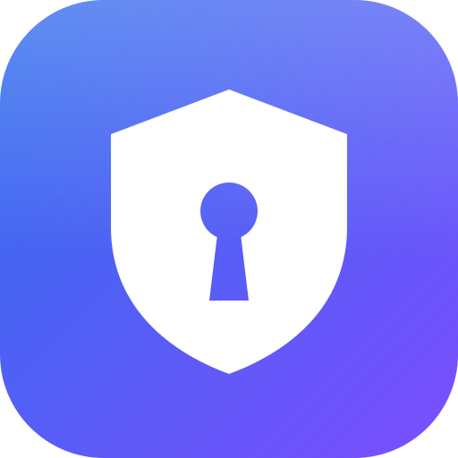
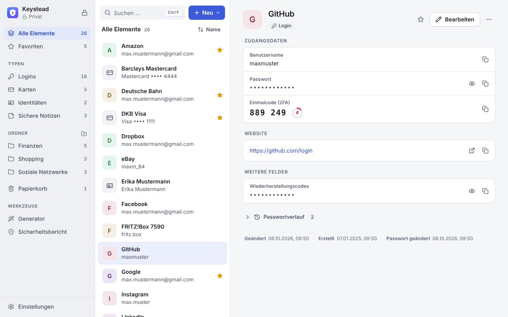
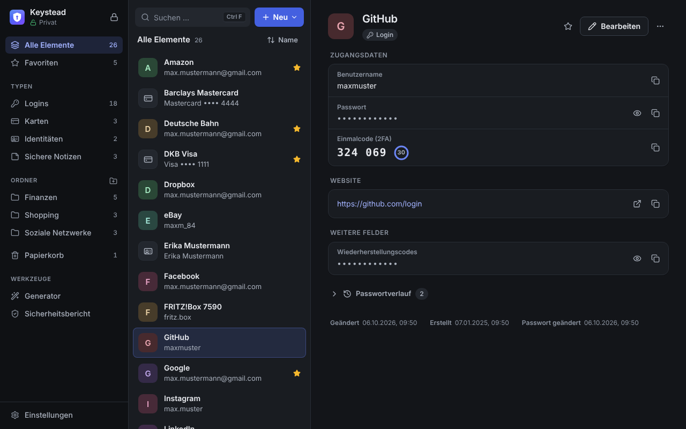
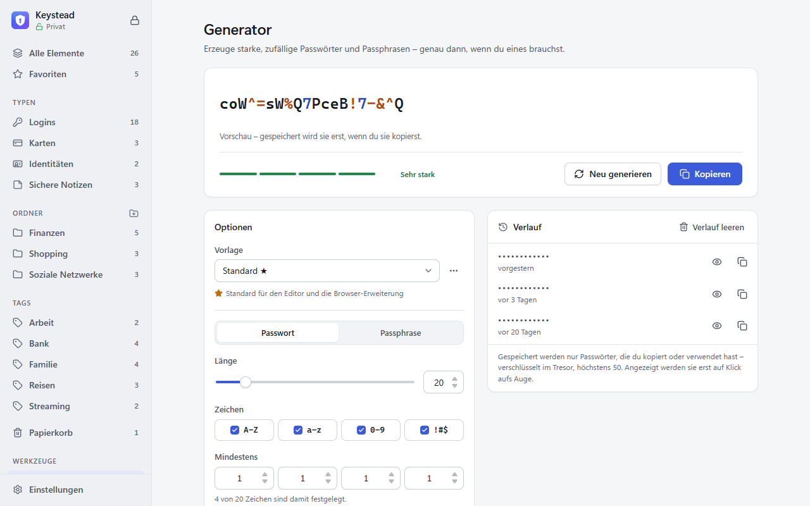
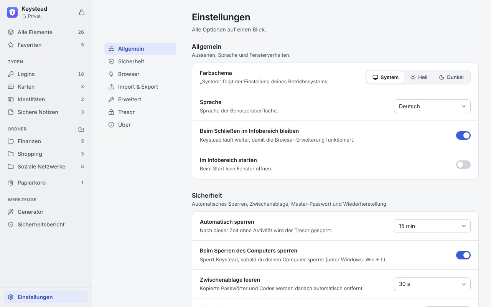

<p align="center">
  
</p>

<h1 align="center">Keystead</h1>

<p align="center">
  Lokaler Passwort-Manager für Windows – mit Browser-Erweiterung, Terminal-Version und Android-App (Vorschau).<br>
  <em>A local password manager for Windows – with a browser extension, a terminal version and an Android app (preview).</em>
</p>

<p align="center">
  <a href="#deutsch">Deutsch</a> · <a href="#english">English</a>
</p>

<p align="center">
  
</p>

<p align="center">
  
  
  
</p>

---

<a id="deutsch"></a>

## Was ist Keystead?

**Keystead** = *Key* + *Homestead*: deine Schlüssel bleiben zu Hause. Keystead ist
ein Passwort-Manager im Stil von Bitwarden oder 1Password – aber **komplett lokal**.
Es gibt keinen Keystead-Server und kein Konto; deine Tresore liegen verschlüsselt
auf deinem Rechner. Nur wenn du es einschaltest, legt Keystead eine verschlüsselte
Kopie in einen Ordner deiner eigenen Cloud (Nextcloud, OneDrive) – für die
Android-App; das Hochladen übernimmt deine Cloud-App.

Keystead 2.0 ist der Nachfolger von VaultX 1.x (PowerShell). Alte VaultX-Tresore
lassen sich übernehmen, siehe [Alte VaultX-Tresore](#alte-vaultx-tresore).

> **Status:** Testversion (Beta). Erstelle regelmäßig einen verschlüsselten Export
> als Sicherung – Dateianhänge sind darin nicht enthalten, sichere dafür den
> Datenordner (siehe [Wo liegen meine Daten?](#wo-liegen-meine-daten)).

### Funktionen

- **Tresore** für Logins, Zahlungskarten, Identitäten und sichere Notizen – mit
  Ordnern, Tags, Favoriten, Papierkorb, eigenen Feldern und Passwortverlauf.
- **Tags**: freie Schlagwörter je Eintrag („Bank“, „Familie“ …), als Filter in
  der Seitenleiste, als Chips in Detailansicht und Editor, in der Suche;
  Umbenennen und Löschen eines Tags wirkt auf alle Einträge.
- **Dateianhänge**: an jeden Eintrag lassen sich bis zu 10 Dateien (je bis 20 MB)
  anhängen, z. B. ein Ausweis-Scan oder ein Vertrag – verschlüsselt neben der
  Tresordatei gespeichert, mit Bildvorschau in der App und „Speichern unter …“.
- **Website-Icons**: Logins zeigen automatisch das Icon ihrer Website – die App
  lädt es selbst direkt von der Website (kein Icon-Dienst) und speichert es
  verschlüsselt im Tresor; abschaltbar unter Einstellungen → Allgemein.
- **Generator** für Passwörter und Passphrasen – in der App erzeugt er nur,
  wenn du auf „Generieren“ klickst (oder Enter/Strg+G drückst). Länge bis
  128 Zeichen, eigene Auswahl an Sonderzeichen, Zeichen, die nie vorkommen
  sollen, Mindestanzahl je Zeichengruppe und auf Wunsch ein Buchstabe am
  Anfang. **Vorlagen**: Standard, Nur Buchstaben und Ziffern, PIN, Lang und
  stark, Passphrase – plus eigene; eine davon ist der Standard für den Editor
  und die Browser-Erweiterung. Passphrasen aus der englischen EFF- oder einer
  deutschen Wortliste. Der **Verlauf** behält nur Passwörter, die du kopiert
  oder verwendet hast, und zeigt sie maskiert – erst ein Klick aufs Auge deckt
  eines auf.
- **Einmalcodes (TOTP/2FA)** direkt im Eintrag, kompatibel mit Google Authenticator & Co.
- **Sicherheitsbericht**: schwache, mehrfach verwendete und alte Passwörter.
- **Geleakte Passwörter**: auf Knopfdruck prüft der Sicherheitsbericht alle
  Passwörter gegen bekannte Datenlecks (Have I Been Pwned), der Editor ein
  einzelnes. Dabei verlassen nur die ersten 5 Zeichen eines Prüfwerts das Gerät,
  nie ein Passwort – siehe [Sicherheit in Kürze](#sicherheit-in-kürze). Nichts
  läuft automatisch.
- **Wiederherstellungsschlüssel**, falls das Master-Passwort vergessen wird.
- **Automatische Sperre** nach Inaktivität und beim Sperren des Computers;
  kopierte Passwörter werden aus der Zwischenablage gelöscht.
- **Browser-Erweiterung** für Chrome, Edge, Brave, Chromium und Vivaldi: Logins
  ausfüllen (auch in Web-Komponenten), neue Logins speichern, Passwörter
  generieren – bei der Registrierung schlägt sie direkt im Feld ein starkes
  Passwort vor. Nach dem Ausfüllen eines Logins mit 2FA kopiert die App den
  aktuellen Code (wird automatisch wieder gelöscht), und das Code-Feld der
  nächsten Seite bietet „2FA-Code einfügen“ an.
- **Terminal-Version** (`keystead-cli`) mit Vollbild-Oberfläche und Befehlen für Skripte.
- **Import** aus VaultX 1.x, Chrome, Edge, Firefox, Bitwarden (CSV/JSON) und
  Keystead-Exporten – Datei einfach ins Fenster ziehen, das Format wird erkannt.
  Eine Vorschau zeigt vorher, was neu ist; vorhandene Einträge werden nicht doppelt
  übernommen, bei geändertem Passwort entscheidest du. **Export** als verschlüsselte
  `.keystead`-Datei, CSV oder Bitwarden-JSON.
- **Aufs Handy**: „Kopie im Cloud-Ordner aktuell halten“ legt jeden Tresor, den
  du öffnest, verschlüsselt in einen Ordner deiner Nextcloud oder deines OneDrive
  und hält ihn nach jedem Speichern aktuell; die [Android-App](#android-app-vorschau)
  liest ihn von dort (nur lesend).
- **Portabler Modus** (Daten neben der EXE, z. B. auf einem USB-Stick),
  Infobereich-Symbol, helles/dunkles Design, Deutsch und Englisch.

### Download & Schnellstart

1. Unter [Releases](../../releases) die neueste
   Version herunterladen:
   - `Keystead-<version>-windows-portable.zip` – entpacken und `Keystead.exe`
     starten, keine Installation nötig. Enthält auch `keystead-cli.exe`, den Ordner
     `browser-extension` und die Kurzanleitung `LIESMICH.txt`.
   - `Keystead-<version>-windows-setup.exe` – klassischer Installer (ohne
     Administratorrechte; installiert nach `%LOCALAPPDATA%\Keystead`, ohne portablen
     Modus). Die installierte Version **aktualisiert sich selbst**, siehe [Updates](#updates).
   - `Keystead-<version>-browser-extension.zip` – nur die Browser-Erweiterung.
2. Die EXE ist nicht signiert. Zeigt Windows SmartScreen „Der Computer wurde durch
   Windows geschützt“, auf „Weitere Informationen“ → „Trotzdem ausführen“ klicken.
3. Beim ersten Start einen Tresor anlegen und ein starkes Master-Passwort wählen;
   dabei lässt sich auch festlegen, ob Keystead Website-Icons automatisch lädt
   (siehe [Sicherheit in Kürze](#sicherheit-in-kürze), jederzeit änderbar unter
   Einstellungen → Allgemein).
   Danach gleich einen **Wiederherstellungsschlüssel** erstellen und sicher
   aufbewahren – ohne ihn ist ein vergessenes Master-Passwort nicht wiederherstellbar.

Voraussetzung: Windows 10 oder 11 (die benötigte WebView2-Laufzeit ist dort in aller
Regel schon installiert).

### Android-App (Vorschau)

Jedes Release enthält auch die Android-App – vorerst als **frühe
Vorschau** zum Nachschlagen: Tresore öffnen, Benutzernamen, Passwörter und
2FA-Codes zeigen und kopieren, den Sicherheitsbericht zeigen – ändern kann sie
nichts. Ihre Tresore holt sie **nur lesend aus einem Ordner deiner eigenen
Cloud** (über die Cloud-App auf dem Handy, z. B. Nextcloud oder OneDrive – mit
diesen Apps ist das noch ungeprüft, siehe unten); einen Tresor neu anlegen kann
sie nicht.

**Installieren:**

1. Auf dem Handy unter [Releases](../../releases) `Keystead-<version>-android.apk`
   herunterladen (Android 10 oder neuer, 64-Bit-ARM – praktisch jedes Handy ab 2019).
2. Die Datei öffnen. Beim ersten Mal fragt Android, ob der Browser bzw. die
   Dateien-App unbekannte Apps installieren darf – in den angezeigten
   Einstellungen zulassen und zurück zur Installation. Google Play Protect kann
   zusätzlich warnen, weil die App nicht aus dem Play Store kommt.
3. Echtheit prüfen (freiwillig, am PC mit den Android-Build-Tools):
   `apksigner verify --print-certs Keystead-<version>-android.apk` muss als
   SHA-256 des Zertifikats genau diesen Wert zeigen (apksigner schreibt ihn
   klein und ohne Doppelpunkte):
   ```text
   B7:3D:75:D6:F7:F4:60:5B:0B:4A:7A:3A:8E:00:6E:E8:E3:D0:81:F1:C3:37:85:BC:79:98:A8:8F:02:1F:3C:AA
   ```
   Jede echte Keystead-APK trägt dieses Zertifikat, und Android installiert ein
   Update nur, wenn es mit demselben Zertifikat signiert ist.
4. **Updates:** die neuere APK herunterladen und über die vorhandene
   installieren – deine Daten bleiben. Die App sucht nicht selbst nach neuen
   Versionen, weil sie keinen Internetzugriff hat; unter **Einstellungen → Über
   Keystead** öffnet „Releases auf GitHub öffnen“ die Releases-Seite im Browser.

**Tresor aufs Handy holen:**

1. **Am PC** unter **Einstellungen → Handy** „Kopie im Cloud-Ordner aktuell
   halten“ einschalten und einen Ordner in deinem Nextcloud- oder
   OneDrive-Ordner wählen, z. B. `Nextcloud\Keystead`. Keystead legt jeden
   Tresor, den du am PC öffnest, samt Anhängen dort hinein und aktualisiert ihn
   nach jedem Speichern; deine Cloud-App am PC lädt ihn hoch.
2. **Auf dem Handy** die Nextcloud- oder OneDrive-App installieren und mit
   demselben Konto anmelden.
3. In Keystead auf dem Handy „Cloud-Ordner wählen“ tippen (später unter
   Einstellungen → Synchronisierung) und im Android-Dialog über die Cloud-App
   denselben Ordner wählen – „Diesen Ordner verwenden“, „Zulassen“.

> **Noch ungeprüft:** Schritt 3 klappt nur, wenn deine Cloud-App ihre Ordner
> in Androids Ordner-Dialog anbietet – nicht jede tut das. Geprüft ist der Weg
> bisher nur mit dem eingebauten Speicher des Handys (im Emulator), noch nicht
> auf einem echten Handy mit der Nextcloud- oder der OneDrive-App. Bietet deine
> Cloud-App dort keinen Ordner an (oder bleibt „Diesen Ordner verwenden“
> ausgegraut), kommt auf diesem Weg kein Tresor aufs Handy.

Weitere Tresore kommen von selbst mit: Öffne sie einmal am PC, dann liegen sie
im selben Ordner. Das Handy behält nur Lesezugriff auf den Ordner und gleicht
beim Start, beim Zurückkehren in die App (höchstens einmal pro Minute) und auf
Knopfdruck ab: Eine neuere Version vom PC ersetzt die Kopie auf dem Handy, eine
ältere nie; in den Ordner schreibt die App nichts. Eine Kopie, die sich auf
dem Handy nicht öffnen lässt (beschädigt oder im Ordner verändert), übernimmt
die App nicht – sie bleibt bei der letzten, die sich geöffnet hat. Hast du am PC das
Master-Passwort geändert, sperrt sich der Tresor auf dem Handy beim nächsten
Abgleich, und ab dann gilt das neue Passwort. Im Ordner liegen nur
verschlüsselte Dateien: `<Tresor-ID>.keystead` und der Ordner
`<Tresor-ID>.keystead.attachments` mit den verschlüsselten Anhängen – die
Dateinamen sind Tresor-IDs. Dein Cloud-Anbieter sieht die verschlüsselten Daten
und den unverschlüsselten Dateikopf (Tresorname, Revision, Zeiten), nie den
Inhalt; Keystead selbst verbindet sich mit keinem Cloud-Dienst.

**Was die App kann:** Tresor entsperren, Einträge suchen und nach Ordnern,
Tags und Typen filtern, Passwörter aufdecken und kopieren (die Zwischenablage
wird wie am PC wieder geleert), 2FA-Codes, Bildvorschau von Anhängen,
Sicherheitsbericht (ohne Prüfung auf geleakte Passwörter), automatische Sperre.
Verlässt du die App, sperrt sie sich nach 1 Minute (einstellbar unter
Einstellungen → Sicherheit: sofort, 1 min, 5 min, nie). Die App hat keinerlei
Internetzugriff (nicht einmal die Berechtigung dafür), verhindert Screenshots
und wird von Android nicht in die Cloud gesichert.

**Mit Fingerabdruck entsperren** (Einstellungen → Sicherheit; aus, bis du es
einschaltest – dafür braucht das Handy eine Displaysperre und einen
eingerichteten Fingerabdruck): Der Schlüssel aus deinem Master-Passwort liegt
dann vom Android-Keystore versiegelt auf dem Handy und wird nur nach deinem
Fingerabdruck freigegeben – ohne PIN oder Muster als Ersatz. Beim Start und
nach der Sperre im Hintergrund fragt Keystead von selbst nach dem Finger, das
Master-Passwort geht immer auch. Nach einem neu eingerichteten Fingerabdruck
oder einem am PC geänderten Master-Passwort fragt Keystead wieder nach dem
Passwort und bietet danach an, den Fingerabdruck neu einzurichten.

**Was noch fehlt:** Bearbeiten am Handy (Einträge, Ordner, Tags, neue Tresore
– das geht nur am PC), Ausfüllen in anderen Apps (Android-Autofill, als
Nächstes geplant), Website-Icons laden und die Prüfung auf geleakte Passwörter
(nur am PC; Icons, die der PC geladen hat, zeigt das Handy), Dateien anhängen
oder speichern, einen Tresor vom Handy entfernen (auch einer, den du am PC
löschst, bleibt auf dem Handy). Beim Deinstallieren löscht Android die Daten
der App – auch die Tresore auf dem Handy (der Cloud-Ordner bleibt unberührt).

### Browser-Erweiterung einrichten

1. In Keystead: **Einstellungen → Browser-Integration** → beim Browser auf
   **Aktivieren** klicken (registriert den Native-Messaging-Host `com.keystead.bridge`).
2. Im Browser `chrome://extensions` (Edge: `edge://extensions`) öffnen, den
   **Entwicklermodus** einschalten, **Entpackte Erweiterung laden** und den Ordner
   wählen, den Keystead unter **Einstellungen → Browser-Integration** anzeigt
   (**Ordner öffnen** / **Pfad kopieren**) – das ist `browser-extension` im
   Datenordner, z. B. `%LOCALAPPDATA%\Keystead\browser-extension`. Die
   Erweiterungs-ID ist immer `imfndemblnaalppnmdplagajjielnaok`.
3. Auf das Keystead-Symbol in der Browserleiste klicken → **Mit Keystead verbinden**
   und den angezeigten 6-stelligen Code in der App bestätigen.

Keystead legt die Erweiterung bei jedem Start in diesen Ordner und hält sie dort
aktuell: Nach einem App-Update lädt sich die Erweiterung selbst neu. Wurde sie aus
einem anderen Ordner geladen (z. B. aus einer ZIP-Datei), zeigt ihr Popup „Neue
Plugin-Version verfügbar“ mit dem richtigen Ordner – dann einmal von dort laden.
Wird `Keystead.exe` verschoben, einfach einmal starten; die Registrierung wird
automatisch aktualisiert.

Tastenkürzel: `Strg+Umschalt+Y` öffnet das Popup, `Strg+Umschalt+L` füllt das
Login der Seite aus, `Strg+Umschalt+9` setzt ein neues Passwort ins aktive Feld.

<a id="updates"></a>

### Updates

Keystead sucht beim Start und danach alle 6 Stunden nach einer neuen Version
(abschaltbar unter **Einstellungen → Über Keystead**, dort auch **Nach Updates
suchen**). Ist eine da, erscheint oben ein Hinweis: **Jetzt aktualisieren** lädt das
Update, prüft seine **Signatur** (nur von den Keystead-Entwicklern signierte Updates
werden installiert), sperrt den Tresor und startet Keystead neu – **Später** blendet
den Hinweis bis zum nächsten Start aus.

- **Update-Kanal:** „Nur stabile Versionen“ (Standard) oder „Beta-Versionen“
  (enthält auch stabile Versionen).
- **Manuell herunterladen:** Unter Einstellungen → Über Keystead öffnet
  „Releases auf GitHub öffnen“ die Release-Seite im Browser (daneben „Kopieren“
  für den Link), falls die Update-Prüfung nicht durchkommt, etwa weil GitHub für
  die App blockiert ist.
- Die **portable ZIP-Version** aktualisiert sich nicht selbst; sie meldet neue
  Versionen mit einem Link zum Download.
- Die **Android-App** sucht nicht nach Updates (sie hat keinen Internetzugriff);
  die neuere APK installierst du über die alte, siehe [Android-App](#android-app-vorschau).
- Bei der Prüfung wird nur eine Versionsdatei (`latest.json`) von GitHub abgerufen –
  keine Tresordaten, keine Kennungen.

### Terminal-Version

In der App unter **Einstellungen → Erweitert → Terminal öffnen**, mit
`Keystead.exe --cli` oder direkt in einer Konsole:

```text
keystead-cli                      Vollbild-Oberfläche (Tresor wählen, entsperren, suchen, kopieren)
keystead-cli vaults               alle Tresore auflisten
keystead-cli list                 Einträge eines Tresors auflisten
keystead-cli get github --copy    Passwort von „github“ kopieren (--field username|totp|notes|uri)
keystead-cli generate --length 24 Passwort erzeugen (--passphrase für eine Passphrase)
```

`--vault NAME` wählt den Tresor. Hilfe: `keystead-cli --help`.

### Wo liegen meine Daten?

| System | Ordner |
|---|---|
| Windows | `%LOCALAPPDATA%\Keystead` |
| Linux | `~/.local/share/keystead` |
| macOS | `~/Library/Application Support/Keystead` |
| Portabler Modus | Ordner `Keystead-Data` neben `Keystead.exe` |
| Android | App-eigener Ordner `/data/user/0/io.github.cedrickgd.keystead` – nur für die App lesbar, wird beim Deinstallieren gelöscht; dazu `sync/link.json` (der verbundene Cloud-Ordner, ohne Geheimnisse) und, wenn eingeschaltet, `device-unlock/<Tresor-ID>.json` (der vom Android-Keystore versiegelte Schlüssel für das Entsperren per Fingerabdruck) |
| Cloud-Kopie (wenn eingeschaltet) | der Ordner aus **Einstellungen → Handy**: `<id>.keystead` und `<id>.keystead.attachments\` – verschlüsselte Kopien; gearbeitet wird weiter im Datenordner |

Darin: `vaults\<id>.keystead` (verschlüsselter Tresor, plus `.bak` mit dem vorherigen
Stand), `vaults\<id>.keystead.attachments\` (die verschlüsselten Dateianhänge dieses
Tresors – zusammen mit der Tresordatei sichern), `settings.json` (Einstellungen,
nicht geheim), `bridge-clients.json`
(verbundene Browser, nur Hashes) und `browser-extension` (die Browser-Erweiterung,
von der App verwaltet). Den portablen Modus schaltest du unter
**Einstellungen → Erweitert** um – oder du legst den Ordner `Keystead-Data` selbst an.

### Sicherheit in Kürze

- Jeder Tresor hat einen zufälligen 256-Bit-Schlüssel, der die Daten mit
  **XChaCha20-Poly1305** verschlüsselt. Das Master-Passwort wird mit **Argon2id**
  (64 MiB, 3 Durchläufe) zu einem Schlüssel, der nur diesen Tresorschlüssel umhüllt.
- Tresor-ID und Revision sind an den Geheimtext gebunden; Manipulationen fallen auf.
- Der Wiederherstellungsschlüssel (125 Bit) umhüllt den Tresorschlüssel ein zweites Mal.
- Beim Ändern des Master-Passworts oder des Wiederherstellungsschlüssels bekommt der
  Tresor einen neuen Schlüssel: Mit dem alten Geheimnis und einer alten Kopie der
  Datei lässt sich kein neuerer Stand öffnen. Ein vorhandener
  Wiederherstellungsschlüssel wird deshalb beim Ändern des Master-Passworts durch
  einen neuen ersetzt, den die App einmal anzeigt.
- Keine Netzwerkverbindungen für deine Daten: Die Erweiterung spricht per Native
  Messaging mit der App, die App lauscht nur auf einer lokalen Named Pipe bzw. einem
  Unix-Socket, die ausschließlich dem eigenen Benutzer zugänglich sind. Ins Internet
  gehen nur die (abschaltbare) Update-Prüfung bei GitHub, – ebenfalls abschaltbar –
  das Laden der Website-Icons und, ausschließlich auf Knopfdruck, die Prüfung auf
  geleakte Passwörter (siehe unten). „Kopie im Cloud-Ordner aktuell halten“
  schreibt nur die verschlüsselten Dateien in einen lokalen Ordner deiner Wahl;
  hochladen tut deine Cloud-App.
- Website-Icons werden direkt bei der jeweiligen Website abgerufen (nur `https`,
  ohne Cookies, ohne Tresordaten); die Website sieht dabei wie bei jedem Besuch
  deine IP-Adresse. Einen eingerichteten Proxy umgeht die App nie: Ist für eine
  Website ein Proxy eingestellt (System oder `HTTPS_PROXY`), lädt sie deren Icon
  gar nicht. Adressen im lokalen Netz (Router, NAS, `localhost`) werden nie
  angefragt. Die Icons liegen verschlüsselt im Tresor, nicht als lose Dateien.
  Beachte: Zum Laden der Icons kontaktiert die App den Host jeder gespeicherten
  Website – auch von Seiten, die du in diesem Netz nie besuchst. DNS-Server, der
  Betreiber des Netzwerks (z. B. ein öffentliches WLAN) und große CDNs können
  daran die Liste der Websites in deinem Tresor erkennen. Wer das nicht möchte,
  schaltet „Website-Icons automatisch laden“ in den Einstellungen aus.
- Die Prüfung auf geleakte Passwörter läuft nie von selbst – nur wenn du im
  Sicherheitsbericht auf „Geleakte Passwörter prüfen“ oder im Editor auf „Auf Leaks
  prüfen“ klickst; vor dem tresorweiten Lauf erklärt ein Dialog, was passiert. Die
  App sendet dann von jedem Passwort nur die ersten 5 Zeichen seines
  SHA-1-Prüfwerts an `api.pwnedpasswords.com` (Have I Been Pwned, über HTTPS) –
  kein Passwort, keinen Benutzernamen, keine Website. Der Dienst antwortet mit
  allen bekannten Treffern zu diesen 5 Zeichen (viele hundert; die Antworten
  sind auf gleiche Größe aufgefüllt) und erfährt nicht, welches Passwort gemeint
  war; der Vergleich passiert auf deinem Gerät. Das Ergebnis wird weder
  gespeichert noch protokolliert und ist nach dem Sperren weg. Einen
  eingerichteten System-Proxy benutzt die App dafür (er sieht nur den
  Verbindungsaufbau zu `api.pwnedpasswords.com`, nie die 5 Zeichen); lässt sich
  die Proxy-Konfiguration nicht auswerten (z. B. ein PAC-Skript), sendet sie
  nichts und sagt das.
- Updates sind signiert (minisign/Ed25519); die App installiert nur Dateien mit
  gültiger Signatur für genau die angekündigte Version.
- Ein Browser wird erst nach Bestätigung eines 6-stelligen Codes in der App
  verbunden; gespeichert wird nur ein Hash seines Tokens.
- Die Erweiterung füllt nur nach einer Aktion des Nutzers aus und nur Logins, die
  zur tatsächlichen Adresse des Frames passen; `https`-Logins nie in `http`-Seiten.
- Die Oberfläche der App bekommt die Elementliste ohne Passwörter, 2FA-Schlüssel,
  Kartennummern und verborgene Felder. Ein Geheimnis lädt sie nur, wenn du es
  anzeigst (nach 30 s wieder verborgen) oder das Element bearbeitest; beim Kopieren
  kopiert die App selbst, ohne dass der Wert die Oberfläche erreicht. Für den
  Generator-Verlauf gilt dasselbe: Die Oberfläche bekommt nur Datum und Kennung
  der Einträge.
- Dateianhänge liegen als einzeln verschlüsselte Dateien (eigener Zufallsschlüssel
  je Anhang, gespeichert im Tresor) im Ordner neben der Tresordatei – nie im
  Klartext auf der Platte, und in keinem Export enthalten; die Oberfläche bekommt
  nur Namen und Größen, eine Bildvorschau nur auf Wunsch (nach 30 s wieder weg).
  Eine vollständige Sicherung ist der Datenordner (Tresordatei und Anhänge-Ordner).
  Ältere Keystead-Versionen öffnen einen Tresor mit Anhängen nicht.

Details: [docs/ARCHITECTURE.md](docs/ARCHITECTURE.md).

### Alte VaultX-Tresore

Tresore aus **VaultX 1.x** (der alten PowerShell-Version) übernimmst du beim
ersten Start über **„Von VaultX umsteigen“** oder später unter
**Einstellungen → Import & Export → Importieren**. Keystead findet sie automatisch unter
`%LOCALAPPDATA%\VaultX` (`accounts.json` + `vault_*.json`); entsperrt wird mit dem
alten Master- oder Wiederherstellungspasswort. Die frühere Zwei-Faktor-Sperre des
Tresors wird nicht übernommen.

Aus dem Quellcode bauen: siehe [Build from source](#build-from-source).

### Wortlisten für Passphrasen

Keystead enthält zwei Wortlisten, die unter ihren eigenen Lizenzen stehen:

- Englisch: die [EFF Large Wordlist](https://www.eff.org/dice) © Electronic
  Frontier Foundation, lizenziert unter
  [CC BY 4.0](https://creativecommons.org/licenses/by/4.0/); Keystead hat die
  Würfelnummern entfernt.
- Deutsch: `de-7776` aus [dys2p/wordlists-de](https://github.com/dys2p/wordlists-de)
  von dys2p, genutzt unter CC0 1.0; Keystead hat 52 Wörter entfernt, damit
  Passphrasen familientauglich bleiben.

Dasselbe steht in der App unter **Einstellungen → Über Keystead** und in der
`LIESMICH.txt` der ZIP-Version; Details in
[crates/keystead-core/src/wordlist/README.md](crates/keystead-core/src/wordlist/README.md).

---

<a id="english"></a>

## What is Keystead?

**Keystead** = *Key* + *Homestead*: your keys stay at home. Keystead is a password
manager in the spirit of Bitwarden or 1Password – but **entirely local**. There is
no Keystead server and no account; your vaults are stored encrypted on your
computer. Only if you turn it on, Keystead puts an encrypted copy into a folder of
your own cloud (Nextcloud, OneDrive) – for the Android app; your cloud app does
the upload.

Keystead 2.0 is the successor of VaultX 1.x (PowerShell); old VaultX vaults can be
imported (see [Legacy VaultX vaults](#legacy-vaultx-vaults)). The UI is German first
and also available in English.

> **Status:** beta. Keep an encrypted export as a backup – attachments are not part
> of it, back up the data directory for those (see [Where is my data?](#where-is-my-data)).

### Features

- **Vaults** with logins, payment cards, identities and secure notes – folders,
  tags, favourites, trash, custom fields and password history.
- **Tags**: free keywords per entry ("Bank", "Family" …), as a filter in the
  sidebar, as chips in the detail view and the editor, and in search; renaming
  or deleting a tag applies to every entry.
- **File attachments**: up to 10 files (20 MB each) per entry, e.g. an ID scan or a
  contract – stored encrypted next to the vault file, with an in-app image preview
  and "Save as …".
- **Website icons**: logins show their website's icon automatically – the app loads
  it itself, directly from the website (no icon service), and stores it encrypted in
  the vault; can be switched off in Settings → General.
- **Generator** for passwords and passphrases – in the app it generates only
  when you click "Generate" (or press Enter/Ctrl+G). Length up to
  128 characters, your own set of symbols, characters that must never appear,
  a minimum per character group and, if you like, a letter first.
  **Presets**: Standard, Letters and digits only, PIN, Long and strong,
  Passphrase – plus your own; one of them is the default for the editor and
  the browser extension. Passphrases from the English EFF or a German word
  list. The **history** keeps only passwords you copied or used and shows
  them masked – a click on the eye reveals one.
- **One-time codes (TOTP/2FA)** inside items, compatible with Google Authenticator & co.
- **Security report**: weak, reused and old passwords.
- **Leaked passwords**: at the press of a button the security report checks all
  passwords against known data breaches (Have I Been Pwned), the editor a single
  one. Only the first 5 characters of a hash leave your device, never a
  password – see [Security design](#security-design). Nothing runs automatically.
- **Recovery key** in case the master password is forgotten.
- **Auto-lock** after inactivity and when the computer is locked; copied secrets are
  cleared from the clipboard.
- **Browser extension** for Chrome, Edge, Brave, Chromium and Vivaldi: fill logins
  (also in web components), save new logins, generate passwords – signup forms get
  a strong password suggested right in the field. After filling a login with 2FA
  the app copies the current code (cleared again automatically), and the code field
  of the next page offers "2FA-Code einfügen" (insert 2FA code).
- **Terminal version** (`keystead-cli`) with a full-screen UI and script-friendly commands.
- **Import** from VaultX 1.x, Chrome, Edge, Firefox, Bitwarden (CSV/JSON) and Keystead
  exports – just drag the file into the window, the format is detected. A preview shows
  what is new first; existing entries are never imported twice, and you decide about
  changed passwords. **Export** as an encrypted `.keystead` file, CSV or Bitwarden JSON.
- **On the phone**: “Keep a copy in a cloud folder up to date” puts every vault you
  open, encrypted, into a folder of your Nextcloud or OneDrive and keeps it up to
  date after every save; the [Android app](#android-app-preview) reads it from there
  (read-only).
- **Portable mode** (data next to the exe, e.g. on a USB stick), tray icon, light/dark theme.

### Download & quick start

1. Get the latest version from [Releases](../../releases):
   - `Keystead-<version>-windows-portable.zip` – unzip and run `Keystead.exe`, no
     installation needed. Also contains `keystead-cli.exe`, the `browser-extension`
     folder and the German quick start `LIESMICH.txt`.
   - `Keystead-<version>-windows-setup.exe` – classic installer (no admin rights
     needed; installs to `%LOCALAPPDATA%\Keystead`, no portable mode). The installed
     version **updates itself**, see [In-app updates](#in-app-updates).
   - `Keystead-<version>-browser-extension.zip` – the browser extension only.
2. The exe is not code-signed. If Windows SmartScreen says "Windows protected your
   PC", click "More info" → "Run anyway".
3. Create a vault with a strong master password on first start; the same step lets
   you decide whether Keystead loads website icons automatically (see
   [Security design](#security-design); changeable any time under Settings →
   General). Then create a **recovery key** and keep it safe – without it a
   forgotten master password cannot be recovered.

Requires Windows 10 or 11 (the WebView2 runtime they need is normally already installed).

### Android app (preview)

Every release also carries the Android app – for now an **early
preview** for looking things up: open vaults, show and copy usernames,
passwords and 2FA codes, show the security report – it cannot change
anything. It takes its vaults **read-only from a folder of your own cloud**
(through the cloud app on the phone, e.g. Nextcloud or OneDrive – not checked
with these apps yet, see below); it cannot create a vault.

**Installing:**

1. On the phone, download `Keystead-<version>-android.apk` from
   [Releases](../../releases) (Android 10 or later, 64-bit ARM – practically
   every phone since 2019).
2. Open the file. The first time, Android asks whether the browser or the
   Files app may install unknown apps – allow it in the settings it shows and
   go back to the installation. Google Play Protect may warn as well, because
   the app does not come from the Play Store.
3. Check it is genuine (optional, on the PC with the Android build tools):
   `apksigner verify --print-certs Keystead-<version>-android.apk` must show
   exactly this certificate SHA-256 (apksigner prints it in lower case without
   colons):
   ```text
   B7:3D:75:D6:F7:F4:60:5B:0B:4A:7A:3A:8E:00:6E:E8:E3:D0:81:F1:C3:37:85:BC:79:98:A8:8F:02:1F:3C:AA
   ```
   Every genuine Keystead APK carries this certificate, and Android installs
   an update only if it is signed with the same one.
4. **Updates:** download the newer APK and install it over the old one – your
   data stays. The app does not look for new versions itself, because it has
   no internet access; under **Settings → About Keystead**, “Open releases on
   GitHub” opens the releases page in the browser.

**Getting a vault onto the phone:**

1. **On the PC**, under **Settings → Phone**, turn on “Keep a copy in a cloud
   folder up to date” and choose a folder inside your Nextcloud or OneDrive
   folder, e.g. `Nextcloud\Keystead`. Keystead puts every vault you open on the
   PC, with its attachments, into it and updates it after every save; your
   cloud app on the PC uploads it.
2. **On the phone**, install the Nextcloud or OneDrive app and sign in with the
   same account.
3. In Keystead on the phone tap “Choose cloud folder” (later under Settings →
   Sync) and, in Android's dialog, pick the same folder through the cloud app –
   “Use this folder”, “Allow”.

> **Not checked yet:** step 3 only works if your cloud app offers its folders
> in Android's folder dialog – not every one does. So far the way has been
> checked only with the phone's built-in storage (in the emulator), not yet on
> a real phone with the Nextcloud or the OneDrive app. If your cloud app offers
> no folder there (or “Use this folder” stays greyed out), no vault reaches the
> phone this way.

More vaults come along by themselves: open them once on the PC and they are in
the same folder. The phone keeps read access to the folder only and syncs at
start, when you return to the app (at most once a minute) and on request: a
newer version from the PC replaces the copy on the phone, an older one never
does; the app writes nothing to the folder. A copy that does not open on the
phone (damaged, or altered in the folder) is not taken – the app stays with the
last one that opened. If you changed the master password
on the PC, the vault on the phone locks at the next sync, and from then on the
new password applies. The folder holds encrypted files only:
`<vault id>.keystead` and the folder `<vault id>.keystead.attachments` with the
encrypted attachments – the file names are vault ids. Your cloud provider sees
the encrypted data and the unencrypted file header (vault name, revision,
times), never the content; Keystead itself connects to no cloud service.

**What the app does:** unlock a vault, search items and filter by folders,
tags and types, reveal and copy passwords (the clipboard is cleared again as on
the PC), 2FA codes, image previews of attachments, the security report (without
the leaked-password check), auto-lock. When you leave the app it locks after
1 minute (adjustable under Settings → Security: immediately, 1 min, 5 min,
never). The app has no internet access at all (not even the permission for
it), blocks screenshots and is not backed up to the cloud by Android.

**Unlock with fingerprint** (Settings → Security; off until you turn it on –
the phone needs a screen lock and an enrolled fingerprint for it): the key
derived from your master password is then kept on the phone sealed by the
Android Keystore and released only after your fingerprint – no PIN or pattern
instead. At start and after the background lock Keystead asks for the finger
by itself; the master password always works too. After a newly added
fingerprint or a master password changed on the PC, Keystead asks for the
password again and then offers to set up the fingerprint once more.

**Still missing:** editing on the phone (items, folders, tags, new vaults –
only on the PC), filling in other apps (Android autofill, planned next),
loading website icons and the leaked-password check (PC only; the phone shows
the icons the PC loaded), attaching or saving files, removing a vault from the
phone (one you delete on the PC stays on the phone too). Uninstalling the app
makes Android delete its data – including the vaults on the phone (the cloud
folder is not touched).

### Browser extension setup

1. In Keystead: **Einstellungen → Browser-Integration** (Settings → Browser
   integration) → click **Aktivieren** (Enable) next to your browser. This registers
   the native messaging host `com.keystead.bridge`.
2. Open `chrome://extensions` (Edge: `edge://extensions`), enable **developer mode**,
   click **Load unpacked** and select the folder Keystead shows under
   **Einstellungen → Browser-Integration** (**Ordner öffnen** / **Pfad kopieren** –
   open folder / copy path): `browser-extension` in the data folder, e.g.
   `%LOCALAPPDATA%\Keystead\browser-extension`. The extension ID is always
   `imfndemblnaalppnmdplagajjielnaok`.
3. Click the Keystead toolbar icon → **Mit Keystead verbinden** (Connect to Keystead)
   and confirm the 6-digit code in the app.

Keystead writes the extension to that folder on every start and keeps it up to
date: after an app update the extension reloads itself. If it was loaded from
another folder (e.g. an unzipped download), its popup shows "Neue Plugin-Version
verfügbar" (new extension version available) with the right folder – load it from
there once. If you move `Keystead.exe`, start it once; the registration is updated
automatically. More: [extension/chrome/README.md](extension/chrome/README.md).

<a id="in-app-updates"></a>

### In-app updates

Keystead looks for a new version at start and every 6 hours (switch it off under
**Settings → About Keystead**, which also has **Check for updates**). A banner offers
**Update now**: the app downloads the update, verifies its **signature** (only
updates signed with the Keystead release key are installed), locks the vault and
restarts. **Later** hides the banner until the next start.

- **Update channel:** stable versions only (default) or beta versions (includes
  stable releases).
- **Download manually:** Settings → About Keystead has "Open releases on GitHub",
  which opens the releases page in the browser (plus a copy button for the link),
  for when the update check cannot get through, e.g. because GitHub is blocked
  for the app.
- The **portable ZIP version** does not update itself; it announces new versions with
  a download link.
- The **Android app** does not look for updates (it has no internet access); install
  the newer APK over the old one, see [Android app](#android-app-preview).
- The check only fetches a version file (`latest.json`) from GitHub – no vault data,
  no identifiers.

### Terminal version

Open it from the app (**Settings → Advanced → Open terminal**), run
`Keystead.exe --cli`, or use `keystead-cli` in a console:

```text
keystead-cli                      full-screen UI (pick vault, unlock, search, copy)
keystead-cli vaults               list all vaults
keystead-cli list                 list the items of a vault
keystead-cli get github --copy    copy the password of "github" (--field username|totp|notes|uri)
keystead-cli generate --length 24 generate a password (--passphrase for a passphrase)
```

`--vault NAME` selects the vault; see `keystead-cli --help`. For scripts the master
password can be passed in `KEYSTEAD_MASTER_PASSWORD` (insecure – other programs and
the shell history may see it).

### Where is my data?

| System | Folder |
|---|---|
| Windows | `%LOCALAPPDATA%\Keystead` |
| Linux | `~/.local/share/keystead` |
| macOS | `~/Library/Application Support/Keystead` |
| Portable mode | `Keystead-Data` folder next to `Keystead.exe` |
| Android | the app's private folder `/data/user/0/io.github.cedrickgd.keystead` – readable by the app only, removed when the app is uninstalled; plus `sync/link.json` (the linked cloud folder, no secrets) and, when turned on, `device-unlock/<vault id>.json` (the key for fingerprint unlock, sealed by the Android Keystore) |
| Cloud copy (when turned on) | the folder from **Settings → Phone**: `<id>.keystead` and `<id>.keystead.attachments/` – encrypted copies; the app keeps working in the data folder |

It contains `vaults/<id>.keystead` (the encrypted vault, plus a `.bak` with the
previous version), `vaults/<id>.keystead.attachments/` (that vault's encrypted file
attachments – back it up together with the vault file), `settings.json` (non-secret
settings), `bridge-clients.json`
(paired browsers, hashes only) and `browser-extension` (the browser extension,
managed by the app). `KEYSTEAD_DATA_DIR` overrides the location.

### Security design

- Every vault has a random 256-bit vault key that encrypts the data with
  **XChaCha20-Poly1305**. The master password is stretched with **Argon2id**
  (64 MiB, t = 3, p = 4) into a key that only wraps the vault key.
- The vault id and revision are bound to the ciphertext as associated data; any
  modification of the file is detected.
- The optional recovery key (125 bits, Crockford base32) wraps the vault key a
  second time.
- Changing the master password or the recovery key gives the vault a new key: the
  old secret together with an old copy of the file opens no newer revision. An
  existing recovery key is therefore replaced by a new one (shown once) when the
  master password changes.
- No network access for your data: the extension talks to the app via Native
  Messaging; the app only listens on a local named pipe (Windows, restricted to the
  current user) or a Unix socket (mode 0600, peer uid checked). The only internet
  access is the update check against GitHub, loading website icons (both can be
  switched off) and – only when you press the button – the leaked-password check
  (see below). “Keep a copy in a cloud folder up to date” only writes the
  encrypted files into a local folder of your choice; your cloud app uploads them.
- Website icons are fetched directly from each website (`https` only, no cookies, no
  vault data); like any visit, the site sees your IP address. The app never goes
  around a proxy: if one is configured for a site (system settings or
  `HTTPS_PROXY`), its icon is not loaded at all. Addresses in the local network
  (router, NAS, `localhost`) are never contacted. The icons are stored encrypted
  inside the vault, not as loose files. Note: to load the icons the app contacts
  the host of every saved website – also sites you never visit from this network.
  DNS resolvers, the network operator (e.g. a public Wi-Fi) and large CDNs can
  therefore see the list of websites in your vault. If you don't want that, turn
  off "Load website icons automatically" in the settings.
- The leaked-password check never runs on its own – only when you click "Geleakte
  Passwörter prüfen" (check for leaked passwords) in the security report or "Auf
  Leaks prüfen" (check for leaks) in the editor; before the vault-wide run a
  dialog explains what happens. The app then sends, for each password, only the
  first 5 characters of its SHA-1 hash to `api.pwnedpasswords.com` (Have I Been
  Pwned, over HTTPS) – no password, no username, no website. The service answers
  with every known match for those 5 characters (many hundreds; answers are padded
  to the same size) and cannot tell which password you meant; the comparison
  happens on your device. The result is neither stored nor logged and is gone
  after a lock. A configured system proxy is used for this (it sees only the
  connection to `api.pwnedpasswords.com`, never the 5 characters); if the proxy
  configuration cannot be evaluated (e.g. a PAC script), the app sends nothing
  and says so.
- Updates are signed (minisign/Ed25519): the app installs only files with a valid
  signature for exactly the announced version.
- A browser is paired only after you confirm a 6-digit code in the app; the app
  stores only a SHA-256 hash of the browser's token.
- The extension fills only after a user action, only logins that match the real URL
  of the frame, and never fills `https` logins into `http` pages.
- Secrets are zeroized in memory where practical, never logged, and copied secrets
  are excluded from the Windows clipboard history and cleared after a timeout.
- The app's web UI gets the item list without passwords, TOTP keys, card numbers
  and hidden fields. It loads a secret only when you reveal it (hidden again after
  30 s) or edit the item; copying is done by the app itself, the value never
  reaches the UI. The same holds for the generator history: the UI gets only
  the entries' dates and ids.
- File attachments are stored as individually encrypted files (each under its own
  random key, kept in the vault) in the folder next to the vault file – never in
  plain text on disk, and never part of an export; the UI gets only names and
  sizes, an image preview only on request (hidden again after 30 s). A complete
  backup is the data directory (vault file plus attachments folder). Older
  Keystead versions refuse a vault with attachments.

The full specification (file format, IPC protocol, commands) is in
[docs/ARCHITECTURE.md](docs/ARCHITECTURE.md).

### Build from source

Requirements: Rust (stable), Node.js 22; on Windows the MSVC build tools; on Linux
`libwebkit2gtk-4.1-dev libayatana-appindicator3-dev librsvg2-dev libxdo-dev libssl-dev`.

```sh
# Desktop app (Keystead / Keystead.exe, on Windows also the NSIS installer)
cd apps/desktop
npm ci
# Without the release signing key (TAURI_SIGNING_PRIVATE_KEY) skip the signed
# updater artifacts – the build itself is the same:
npx tauri build --config '{"bundle":{"createUpdaterArtifacts":false}}'
cd ../..

# Terminal version (keystead-cli / keystead-cli.exe)
cargo build --release -p keystead-tui

# Android app (APK): needs JDK 17, the Android SDK and NDK 28.2.13676358
# (JAVA_HOME, ANDROID_HOME and NDK_HOME set) and the Android Rust targets
# listed in rust-toolchain.toml
cd apps/desktop
npx tauri android build --apk --debug --target x86_64   # for the emulator
npx tauri android build --apk --target aarch64          # for phones
```

Binaries end up in `target/release/`, APKs in
`apps/desktop/src-tauri/gen/android/app/build/outputs/apk/universal/`. Without
the release keystore (`gen/android/keystore.properties`, never committed) an APK
is signed with your local debug key: it installs, but cannot update the
released app (uninstall that first – this deletes the app's data). The browser
extension (`extension/chrome`) needs no build step.

Development:

```sh
cd apps/desktop
npm run dev          # UI in a normal browser with a mock backend (password: demo)
npx tauri dev        # the real desktop app

# checks (as in CI)
cargo fmt --all --check
cargo clippy --workspace --all-targets -- -D warnings
cargo test --workspace
node --test extension/tests/*.test.mjs .github/scripts/*.test.mjs apps/desktop/tests/*.test.mjs
```

Releases: CI (`.github/workflows/build.yml`) versions every build
(`2.0.0-beta.<run>`, or the tag `v<version>`), signs the setup for the in-app updater
with the repository secret `TAURI_SIGNING_PRIVATE_KEY`, builds the Android APK
(signed with the release keystore from the secrets `ANDROID_KEYSTORE_BASE64`,
`ANDROID_KEYSTORE_PASSWORD` and `ANDROID_KEY_ALIAS`, versionCode = run number;
only builds that publish get the secrets) and publishes pre-releases
for commits with `[release]` (stable releases for tags without suffix); see
"Releases & in-app updates" in [docs/ARCHITECTURE.md](docs/ARCHITECTURE.md).
**After tagging a stable `vX.Y.Z`, set `version` in
`apps/desktop/src-tauri/tauri.conf.json` to the next version (e.g. `X.Y.(Z+1)`)** –
otherwise later betas (`X.Y.Z-beta.<run>`) sort below the release and are never
offered by the updater; CI warns, and refuses to publish such a beta.

### Project layout

| Path | Contents |
|---|---|
| `crates/keystead-core` | Crypto, vault file format, storage, generator, TOTP, import/export, URL matching, security report |
| `crates/keystead-bridge` | Browser bridge: protocol, native messaging host, local socket server, host registration |
| `crates/keystead-tui` | Terminal UI and the `keystead-cli` binary |
| `apps/desktop` | Desktop and Android app: React + TypeScript UI (`src/`) and Tauri 2 backend (`src-tauri/`; the Android project in `src-tauri/gen/android`) |
| `extension/chrome` | Manifest V3 browser extension (plain JavaScript) |
| `assets` | Logo and icons |
| `docs` | Architecture & contracts, German quick start, screenshots |

### Legacy VaultX vaults

Vaults of **VaultX 1.x** (the old PowerShell version) can be imported on first start
(**"Von VaultX umsteigen"** / "Switch from VaultX") or later via
**Settings → Import & export → Import**.
Keystead finds them in `%LOCALAPPDATA%\VaultX` (`accounts.json` + `vault_*.json`)
and decrypts them with the old master or recovery password; the old vault-unlock
two-factor secret is not imported.

## License

Proprietary – free for personal, educational and non-commercial use; see
[LICENSE](LICENSE). © 2026 Cedrick Grabe.

### Credits – passphrase word lists

- English: the [EFF large word list](https://www.eff.org/dice) © Electronic
  Frontier Foundation, licensed under Creative Commons Attribution 4.0
  International ([CC BY 4.0](https://creativecommons.org/licenses/by/4.0/),
  see [eff.org/copyright](https://www.eff.org/copyright)); Keystead removed
  the dice numbers.
- German: based on `de-7776` from
  [dys2p/wordlists-de](https://github.com/dys2p/wordlists-de) by dys2p,
  used under CC0 1.0 (the list is offered under Unlicense, CC0 or BSD-3);
  Keystead removed 52 words to keep passphrases family-friendly.

The same credits ship with the app (Settings → *Über Keystead*) and in the
portable ZIP's `LIESMICH.txt`. Details, checksums and the removed words:
[crates/keystead-core/src/wordlist/README.md](crates/keystead-core/src/wordlist/README.md).
